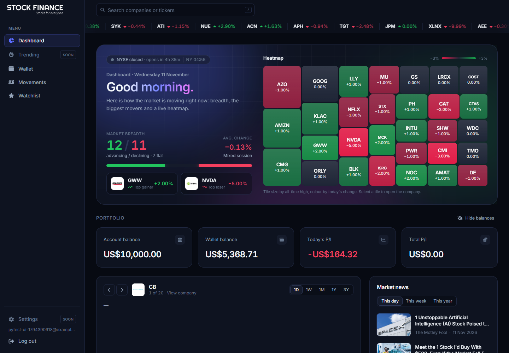
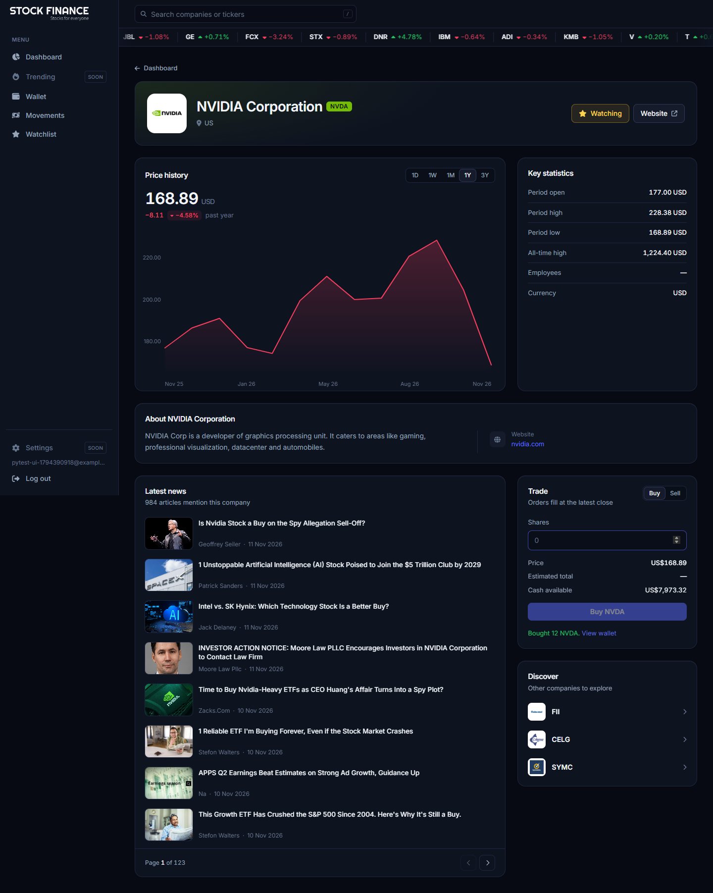
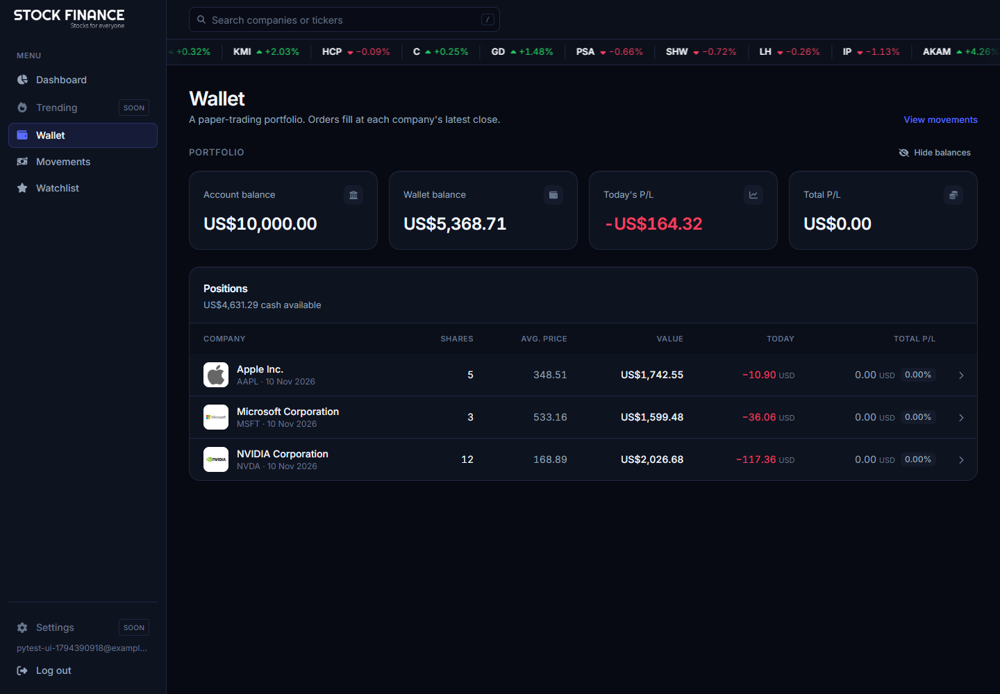
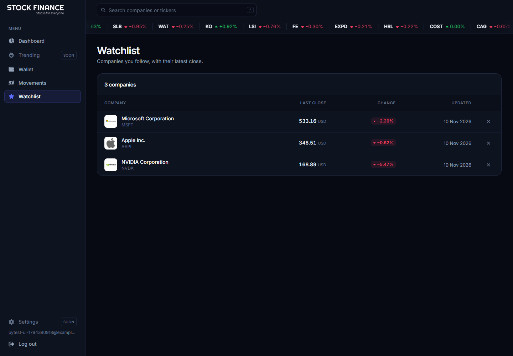
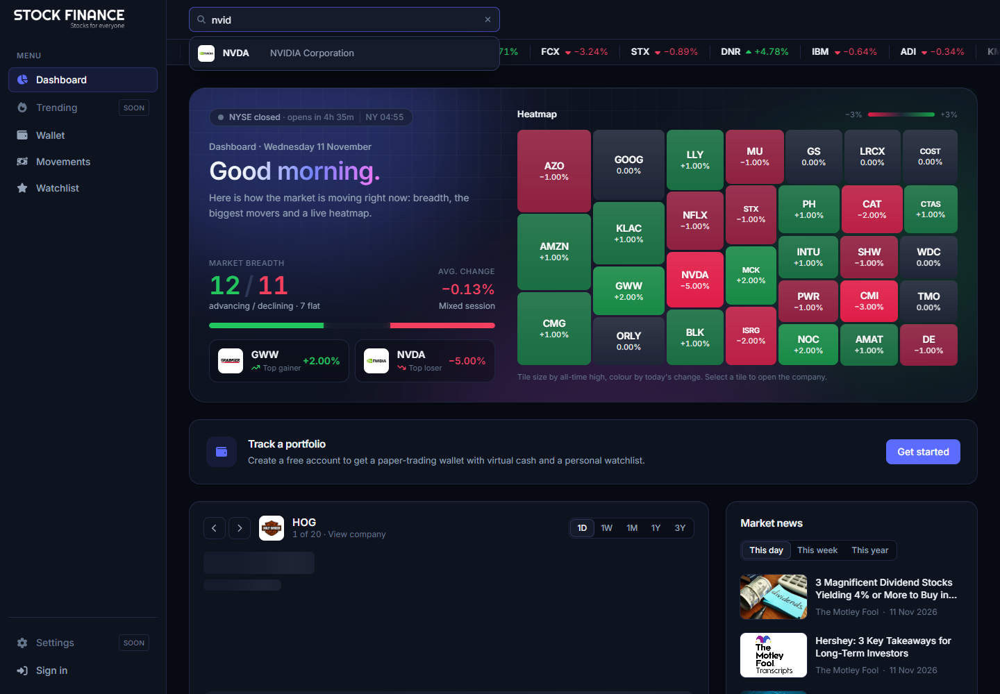
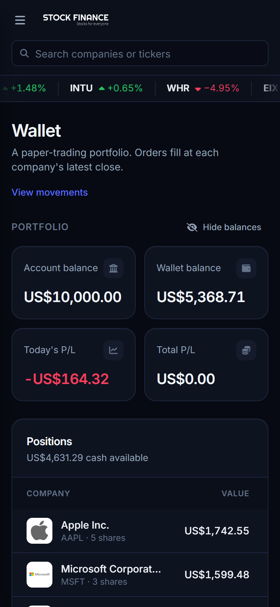
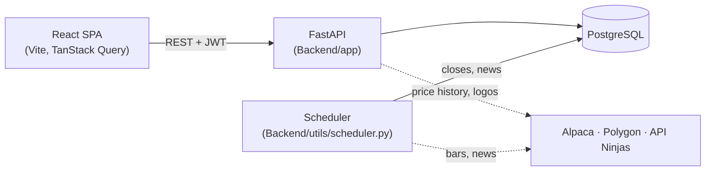
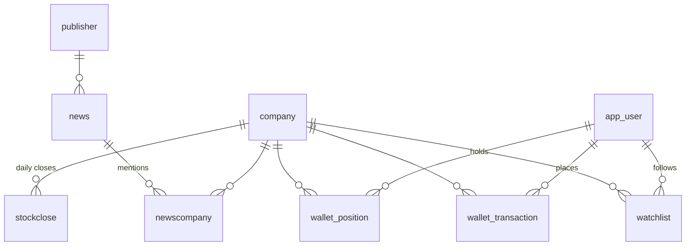

# Stock Finance

A React + FastAPI web app to follow the US stock market: live market heatmap, company profiles with price history, financial news, and a personal **paper-trading wallet** and **watchlist** for signed-in users.



## Features

- **Market dashboard**: heatmap by all-time high and day change, price chart with time ranges, market news, and a ticker tape.
- **Company search** from the header. Matches tickers and names, works from the keyboard (`/` to focus, arrows, Enter).
- **Company pages**: profile, key statistics, price history, related news.
- **Accounts** with email and password (JWT).
- **Paper-trading wallet**: every new account starts with virtual cash (10,000 USD by default). Buying and selling fill at the latest stored close. The wallet shows balance, day P/L, total P/L and movement history.
- **Watchlist**: star companies and follow their latest close and daily change.
- **Scheduled data refresh**: prices and news are reloaded automatically.
- **API hardening**: per-IP rate limiting and a `/health` endpoint.

| Company page | Wallet |
| --- | --- |
|  |  |
| **Watchlist** | **Search** |
|  |  |



## Architecture



- **Frontend** (`Frontend/finance-app-frontend`): React 18, TypeScript, Tailwind, file-based routing ([generouted](https://github.com/oedotme/generouted)), TanStack Query. API types are generated from the backend's OpenAPI schema (`src/api/schema.d.ts`).
- **Backend** (`Backend/app`): FastAPI + SQLAlchemy. Routers live in `api/routers/`, auth/rate-limit/price helpers in `core/`, and tables in `models/`.
- **Data loaders** (`Backend/utils`): scripts that fill the database from Alpaca and Polygon. `scheduler.py` runs them on a cron schedule.
- **Database**: PostgreSQL. The API creates any missing tables on startup.



The original design diagrams are in [`Utils/TechStack.drawio`](Utils/TechStack.drawio) and [`Utils/Diagrams/DatabaseDiagram.drawio`](Utils/Diagrams/DatabaseDiagram.drawio) (open them with [draw.io](https://app.diagrams.net)). The database diagram predates `stockclose` and the account tables, so the ER diagram above is the current one.

## Running locally

### Prerequisites

- Python 3.12, Node.js 20+, PostgreSQL 16 (or Docker)
- Free API keys: [Alpaca](https://alpaca.markets) (prices), [Polygon](https://polygon.io) (news and fallback prices), [API Ninjas](https://api-ninjas.com) (logos)

### Option A: Docker Compose

```bash
cp .env.example .env          # fill in POSTGRES_PASSWORD and the API keys
docker compose up --build
```

| Service | URL |
| --- | --- |
| Frontend | http://localhost:5173 |
| API + interactive docs | http://localhost:8000/docs |
| Health check | http://localhost:8000/health |

Compose also starts the `scheduler` service, which refreshes prices and news on a schedule (see [Keeping data up to date](#keeping-data-up-to-date)).

The database starts empty, and the scheduler only refreshes companies that already exist. Load the data once from your machine as described in [Loading data](#loading-data): the Compose database is published on `localhost:5432`, so use `DATABASE_IP=localhost` in `Backend/app/.env`.

### Option B: run each part yourself

**1. Database**: create an empty PostgreSQL database (for example `stockfinance_db`).

**2. Backend**

```bash
cd Backend
python -m venv .venv
source .venv/bin/activate          # Windows: .venv\Scripts\activate
pip install -r requirements.txt
cp app/.env.example app/.env       # fill in the values (see below)

cd app
uvicorn app.main:app --app-dir .. --reload    # http://127.0.0.1:8000/docs
```

The settings are read from `Backend/app/.env`, so start the API from `Backend/app`.

**3. Frontend**

```bash
cd Frontend/finance-app-frontend
npm install
npm run dev                        # http://localhost:5173
```

### Loading data

The tables are created when the API starts. Then fill them, from `Backend/utils` and with the same `.env`:

```bash
cd Backend/utils
python CompanyDataToDatabaseCSV.py   # 1. companies (one per logo in the frontend)
python StockToCompany.py             # 2. daily closes + all-time high (~3 min)
python ColorPickerCompany.py         # 3. brand colour from each logo
python NewsDataToDatabase.py         # 4. news (~1h30 on Polygon's free plan)
```

Steps 2 and 4 are the ones the scheduler repeats, so you only run them by hand once.

### Keeping data up to date

`Backend/utils/scheduler.py` runs the price and news loaders with [APScheduler](https://apscheduler.readthedocs.io). It runs as a separate process, so the API can scale to several workers without each one running the jobs.

```bash
cd Backend/utils
python scheduler.py                 # run forever on the schedule
python scheduler.py --now           # also run every job once at start-up
python scheduler.py --once stocks   # run one job (stocks | news) and exit
```

| Job | Default schedule (UTC) | What it does |
| --- | --- | --- |
| `stocks` | `0 6 * * tue-sat`: 06:00 after each US trading day | Replaces each company's recent closes and updates the all-time high |
| `news` | `0 7 * * *`: daily 07:00 | Adds new articles from Polygon, skipping known ones |

Override the schedule with `SCHEDULER_STOCKS_CRON`, `SCHEDULER_NEWS_CRON` and `SCHEDULER_TIMEZONE`. Write weekdays as names (`mon`, `tue-sat`): APScheduler counts Monday as 0, unlike classic cron. A failed run is logged and retried at the next slot. A scheduled job never starts while its previous run is still going.

## Configuration

### Backend (`Backend/app/.env`)

| Variable | Required | Default | Description |
| --- | --- | --- | --- |
| `APCA_API_KEY_ID`, `APCA_API_SECRET_KEY` | yes | | Alpaca keys (price history, daily change) |
| `API_NINJA_KEY` | yes | | API Ninjas key (company logos) |
| `POLYGON_API_KEY` | for news | `""` | Polygon key (news, fallback prices) |
| `DOMAIN` | yes | | Public host name, e.g. `localhost` |
| `ENVIRONMENT` | yes | | `local`, `staging` or `production` |
| `DATABASE_NAME`, `DATABASE_IP`, `DATABASE_PORT`, `DATABASE_USER`, `DATABASE_PASSWORD` | yes | | PostgreSQL connection |
| `originCORS` | yes | | JSON list of allowed origins, e.g. `["http://localhost:5173"]` |
| `JWT_SECRET_KEY` | outside `local` | random per start | Signs session tokens. Generate one with `python -c "import secrets; print(secrets.token_urlsafe(32))"`. Without it, local sessions end on every restart |
| `ACCESS_TOKEN_EXPIRE_MINUTES` | no | `1440` | Session length |
| `WALLET_STARTING_BALANCE` | no | `10000` | Virtual cash for new accounts |
| `RATE_LIMIT_ENABLED` | no | `true` | Turns rate limiting on or off |
| `RATE_LIMIT_DEFAULT` | no | `120/minute` | Per-IP limit for every endpoint |
| `RATE_LIMIT_AUTH` | no | `10/minute` | `/auth/login` and `/auth/register` (brute-force protection) |
| `RATE_LIMIT_EXTERNAL` | no | `30/minute` | Endpoints that spend third-party API quota (`/stock/get/`, `/company/discount`, `/company/logo/get/`) |
| `RATE_LIMIT_STORAGE_URI` | no | in memory | e.g. `redis://redis:6379`. Needed to share limits between several API workers |

Docker Compose reads the same values from the root `.env` (see [`.env.example`](.env.example)) and sets `DATABASE_IP=db` itself.

### Frontend

| Variable | Default | Description |
| --- | --- | --- |
| `VITE_API_URL` | `http://127.0.0.1:8000` | API base URL, fixed at build time |

## API overview

The full, always-current reference is the interactive documentation at **`/docs`**.

| Area | Endpoints |
| --- | --- |
| Health | `GET /health`: `200 {"status":"ok","database":"ok"}`, or `503` when the database is unreachable. Not rate limited |
| Auth | `POST /auth/register`, `POST /auth/login` → `{ access_token, user }`. `GET /auth/me` |
| Search | `GET /company/search?q=nvid&limit=10` |
| Wallet | `GET /wallet`, `POST /wallet/transactions` (`{ company_id, side: "buy"/"sell", quantity }`), `GET /wallet/transactions` |
| Watchlist | `GET /watchlist`, `POST /watchlist` (`{ company_id }`), `DELETE /watchlist/{company_id}` |
| Market data | `/company/*`, `/stock/*`, `/news/*` |

Authenticated endpoints expect `Authorization: Bearer <access_token>`. When a client goes over a rate limit, the API answers `429 Too Many Requests`.

## Development

```bash
# Backend tests (they need a reachable PostgreSQL configured in app/.env)
cd Backend/app && python -m pytest ..

# Frontend checks
cd Frontend/finance-app-frontend && npm run lint && npm run build

# After changing the API, regenerate the frontend types
cd Backend && python -m app.export_openapi ../Frontend/finance-app-frontend/openapi.json
cd Frontend/finance-app-frontend && npm run gen:api
```

Behind a reverse proxy, start uvicorn with `--proxy-headers --forwarded-allow-ips=<proxy ip>` so rate limits apply to real client IPs and not to the proxy's.
